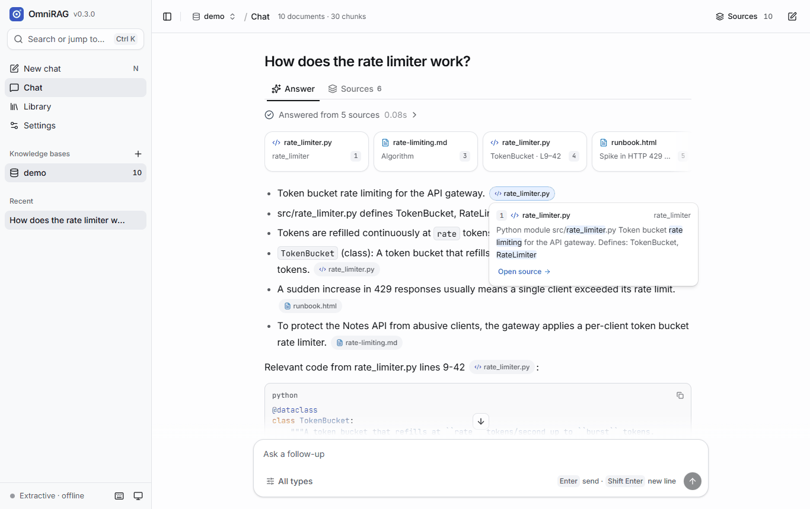
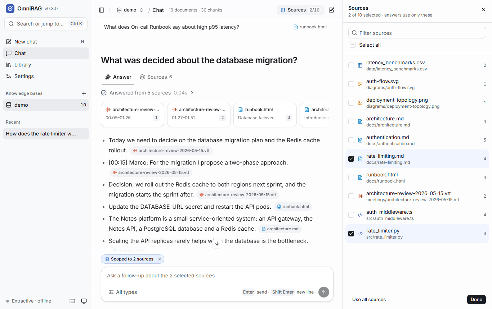
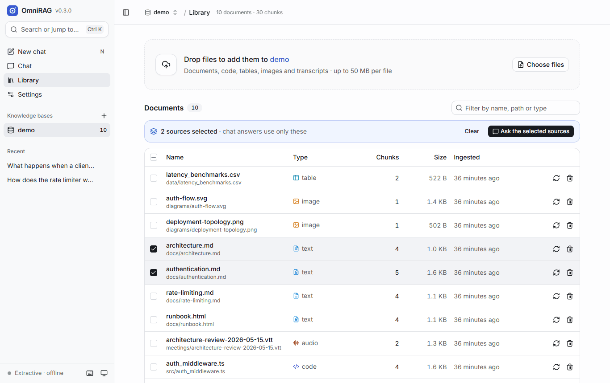
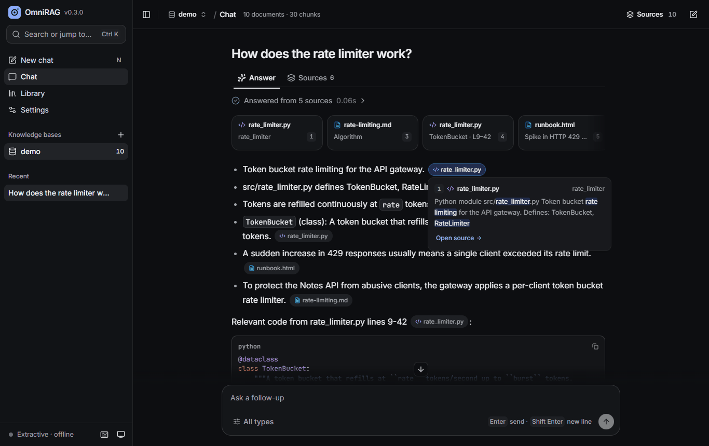
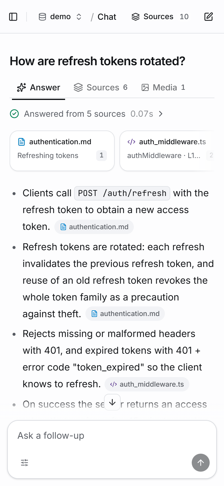

# OmniRAG

**Ask your documents, code, tables, images and transcripts, and get answers that cite the exact
section, line range, rows or timestamp they came from. Self-hosted and offline by default.**

[](https://github.com/Manas-thakur/omnirag/actions/workflows/ci.yml)
[](https://github.com/Manas-thakur/omnirag/releases)
[](LICENSE)
[](pyproject.toml)

[Website](https://manas-thakur.github.io/omnirag/) ·
[Documentation](https://manas-thakur.github.io/omnirag/docs/) ·
[Quickstart](https://manas-thakur.github.io/omnirag/docs/quickstart/) ·
[CLI reference](https://manas-thakur.github.io/omnirag/docs/reference/cli/) ·
[HTTP API](https://manas-thakur.github.io/omnirag/docs/reference/http-api/) ·
[Changelog](CHANGELOG.md)



OmniRAG is a retrieval-augmented knowledge assistant. It maps every modality into one search
space using text as the bridge (captions for images, transcripts for recordings, schemas and
rows for tables, signatures and docstrings for code), retrieves with a from-scratch hybrid
pipeline, and answers with `[n]` citations you can check. The default pipeline needs nothing
beyond `numpy`; plug in Ollama or any OpenAI-compatible endpoint when you want a model to write
the answer.

## Features

- **One index for every modality:** Markdown, HTML, PDF, 18 programming languages, CSV/JSON
  tables, images (captions, alt text, SVG/PNG/EXIF metadata, optional vision model) and
  meeting transcripts or audio.
- **Hybrid retrieval built from scratch:** dense vectors and BM25, reciprocal rank fusion, a
  lexical reranker, MMR de-duplication and neighbouring-chunk context. No LangChain, no
  LlamaIndex.
- **Checked citations:** every claim carries `[n]`; citations that point at nothing are removed.
  Offline extractive answers, or Ollama / any OpenAI-compatible model.
- **Web app:** streaming answers with source cards, citation pills with hover previews, Answer /
  Sources / Media tabs, progress steps and offline "Related" questions; scope a chat to chosen
  documents; a document library with drag-and-drop upload; per-knowledge-base model settings
  with a live status check; `Ctrl K` command palette and keyboard shortcuts; light and dark
  themes; works on a phone.
- **CLI, HTTP API and Python library:** `omnirag` for ingesting, querying and `doctor`; a
  FastAPI server with server-sent-event streaming, upload, document and settings endpoints.
- **Careful when exposed:** optional API key, opt-in CORS, upload size and type limits,
  sanitised file names and a strict Content Security Policy.
- **Incremental and portable:** content-hashed re-ingestion, one SQLite file per knowledge
  base, a multi-arch Docker image on ghcr.io.

## Quickstart

```bash
pip install "omnirag[server,pdf,images] @ git+https://github.com/Manas-thakur/omnirag"

omnirag ingest ./docs ./src --kb notes                     # index folders (creates the KB)
omnirag query "How does the rate limiter work?" --kb notes  # cited answer, offline
omnirag serve --kb notes                                    # web app on http://127.0.0.1:8000
```

Try it on the bundled sample corpus (docs, Python and TypeScript, a CSV, a meeting transcript,
SVG and PNG diagrams):

```bash
git clone https://github.com/Manas-thakur/omnirag && cd omnirag
uv sync --extra server --extra pdf --extra images
make demo      # ingest examples/corpus and run sample queries
make serve     # the web app on the demo knowledge base
```

## Install

| Method | Command |
| ------ | ------- |
| pip, from GitHub | `pip install "omnirag[server,pdf,images] @ git+https://github.com/Manas-thakur/omnirag"` |
| uv tool | `uv tool install "omnirag[server,pdf,images] @ git+https://github.com/Manas-thakur/omnirag"` |
| Release wheel | download from [Releases](https://github.com/Manas-thakur/omnirag/releases), then `pip install "omnirag-0.3.0-py3-none-any.whl[server,pdf,images]"` |
| Docker | `docker run --rm -p 8000:8000 -v omnirag-data:/data ghcr.io/manas-thakur/omnirag:latest` |
| Core only (CLI, no server) | `pip install "omnirag @ git+https://github.com/Manas-thakur/omnirag"` |

Python 3.10+ is required. The web app ships pre-built inside the package, so no Node.js is
needed to run it. PyPI publishing is prepared in the release workflow but not enabled yet.

Optional extras: `server` (web app and API), `pdf` (pypdf), `images` (pillow, EXIF),
`audio` (faster-whisper transcription), `embeddings` (sentence-transformers), `all`.
Check an installation with `omnirag doctor`.
Details: [Installation](https://manas-thakur.github.io/omnirag/docs/installation/).

## Usage

### Command line

```bash
omnirag kb create notes --description "Team notes"
omnirag ingest ./docs ./src ./data --kb notes
omnirag query "What was decided about the database migration?" --kb notes
omnirag query "How are tokens validated? source:*.ts" --kb notes --llm ollama
omnirag search "p95 latency" --kb notes -m table --json
omnirag stats --kb notes
omnirag doctor
```

Every command and flag: [CLI reference](https://manas-thakur.github.io/omnirag/docs/reference/cli/).

### Web app

`omnirag serve` starts the API and the web app. Create a knowledge base with **+**, drop files
into **Library**, and ask in **Chat**. Tick documents (press `S`) to scope answers to them,
hover a citation pill to read the passage, click it to open the source in context. Connect a
model per knowledge base in **Settings**. See the
[web app guide](https://manas-thakur.github.io/omnirag/docs/guides/web-app/).

<p>
  
  
</p>
<p>
  
  
</p>

Screenshots are captures of the bundled sample corpus answered by the offline extractive
answerer.

### Python

```python
from omnirag import IndexManager

kb = IndexManager().get_or_create("notes")
kb.ingest(["./docs", "./src"])
answer = kb.ask("How are refresh tokens rotated?", llm="none")
print(answer.text)
for src in answer.cited_sources:
    print(src.index, src.metadata["path"], src.location)
kb.close()
```

More: [Python API](https://manas-thakur.github.io/omnirag/docs/reference/python-api/) ·
[HTTP API](https://manas-thakur.github.io/omnirag/docs/reference/http-api/).

## Configuration

OmniRAG reads environment variables; per-knowledge-base answer settings chosen in the web app
are stored with each knowledge base.

| Variable | Default | Meaning |
| -------- | ------- | ------- |
| `OMNIRAG_HOME` | `~/.omnirag` | where knowledge bases live |
| `OMNIRAG_KB` | `default` | default knowledge base |
| `OMNIRAG_EMBEDDER` | `hashing` | embedder for new KBs: `hashing[:dim]`, `st:<model>`, `ollama:<model>` |
| `OMNIRAG_LLM` | `none` | answer backend: `none`, `ollama[:model]`, `openai[:model]` |
| `OLLAMA_HOST`, `OMNIRAG_OLLAMA_MODEL` | `http://localhost:11434`, `llama3.1:8b` | Ollama |
| `OPENAI_BASE_URL`, `OPENAI_API_KEY`, `OMNIRAG_OPENAI_MODEL` | `https://api.openai.com/v1`, unset, `gpt-4o-mini` | any OpenAI-compatible endpoint |
| `OMNIRAG_VLM_MODEL` | unset | Ollama vision model for image captions |
| `OMNIRAG_API_KEY` | unset | require a key on `/api/*` |
| `OMNIRAG_CORS_ORIGINS` | unset | browser origins allowed to call the API |
| `OMNIRAG_MAX_UPLOAD_MB` | `50` | per-file upload limit |

All variables, including chunking, timeouts and Whisper:
[Configuration](https://manas-thakur.github.io/omnirag/docs/reference/configuration/).

## Architecture

```text
files ─► ingest ─► chunk ─► embed ─► store (SQLite + numpy)
                                          │
question ─► parse filters ─► dense + BM25 ─► RRF ─► rerank ─► MMR ─► neighbours
                                                                        │
                              answer with [n] citations ◄── LLM or extractive
```

```text
src/omnirag/
├── ingest/      detector, text/pdf/html, code, table, image, audio, orchestrator
├── chunking/    recursive, markdown-heading-aware, line windows
├── embed/       hashing (default), sentence-transformers, Ollama, on-disk cache
├── store/       models and LocalStore (SQLite + exact cosine search on numpy)
├── query/       inline filters, intent, modality hints, rewriter, router
├── retrieve/    BM25, RRF fusion, lexical reranker, MMR, hybrid retriever
├── generate/    context assembly, citation tracking, LLM clients, extractive answerer
├── index/       IndexManager and KnowledgeBase (ingest, search, ask, stats, rebuild)
├── server/      FastAPI app, security middleware, related questions, built web app (static/)
├── cli.py       the omnirag command
└── doctor.py    environment checks
web/             web app sources (Vite, React, TypeScript, Tailwind CSS, shadcn/ui)
site/            landing page and docs (Astro + Starlight)
```

How each stage works: [Concepts](https://manas-thakur.github.io/omnirag/docs/concepts/retrieval/).
Design references for the web app: [docs/design/references.md](docs/design/references.md).

## Development

```bash
# Python
uv sync --extra server --extra pdf --extra images
uv run pytest -q
uv run ruff check . && uv run ruff format --check .

# Web app (Node 20+, pnpm 10)
cd web && pnpm install
pnpm dev                       # :8752, proxies /api to an API on :8751
pnpm typecheck && pnpm lint && pnpm test
pnpm build                     # writes src/omnirag/server/static/ (commit it)

# Docs site
cd site && pnpm install && pnpm build   # validates internal links
uv run python scripts/gen_cli_docs.py   # regenerate the CLI reference
```

CI runs ruff, pytest on Python 3.10–3.12, a CLI smoke test, the web app's type check, lint,
tests and build (and fails if the committed build is stale). Tagged releases build the web app,
the sdist and wheel, a GitHub Release and a multi-arch image on ghcr.io; the docs site deploys
to GitHub Pages.

## Roadmap

Not implemented yet: OCR for scanned PDFs and images, approximate nearest-neighbour indexes and
external vector stores (search is exact, fine for tens of thousands of chunks), CLIP-style image
embeddings, cross-encoder reranking and retrieval evaluation metrics, URL/EPUB/XLSX ingestion,
speaker diarization, user accounts and server-side chat history. The design documents in
[`plans/`](plans/) describe the larger system.

## Contributing

Issues and pull requests are welcome. [CONTRIBUTING.md](CONTRIBUTING.md) covers the setup for
the Python package, the web app and the docs site.

## License

[MIT](LICENSE) © Manas Thakur
