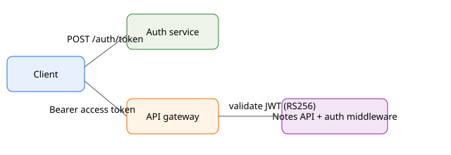
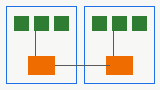

# System Architecture

The Notes platform is a small service-oriented system: an API gateway, the Notes API,
a PostgreSQL database and a Redis cache.

## Request flow

A client request first reaches the API gateway, which terminates TLS and applies the
rate limiter. The gateway forwards the request to the Notes API, where the
authentication middleware validates the JWT before any handler runs.

## Storage

Notes are stored in PostgreSQL 16. Frequently read notes are cached in Redis with a
five minute TTL; writes invalidate the cache entry for the affected note.

## Deployment

The services run on Kubernetes in two regions (us-east and eu-west). Each region has
three API replicas behind a regional load balancer, and the database uses a primary in
us-east with a streaming read replica in eu-west.

