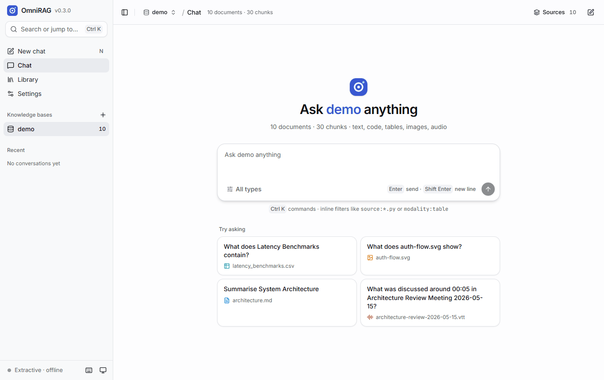
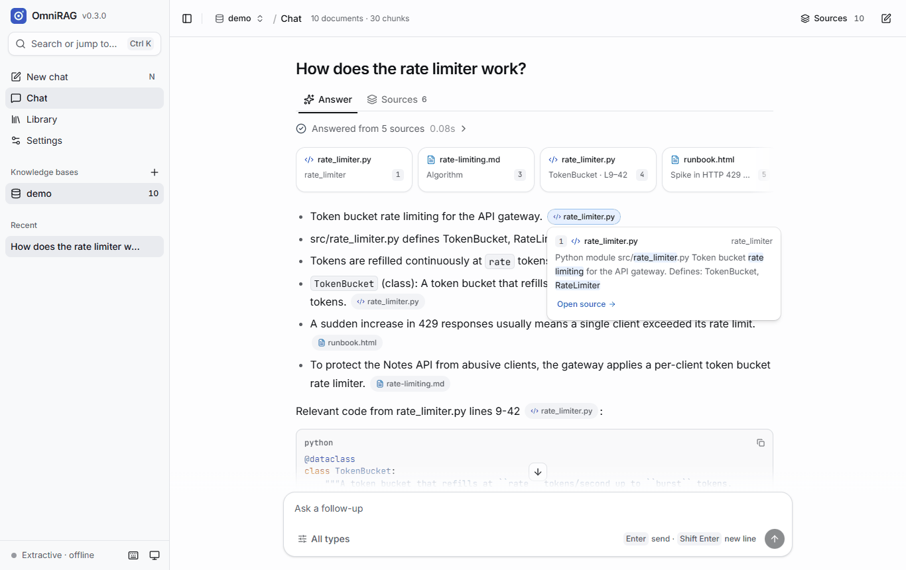
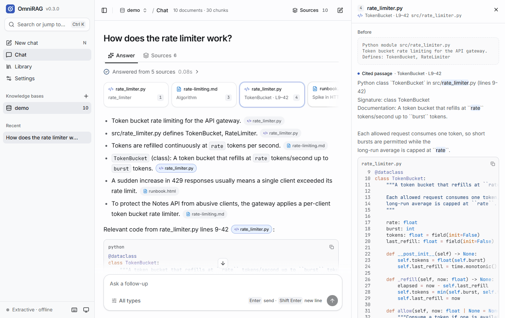
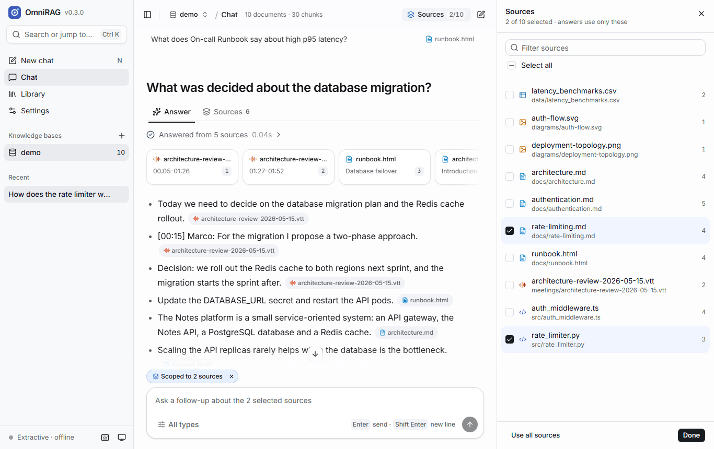
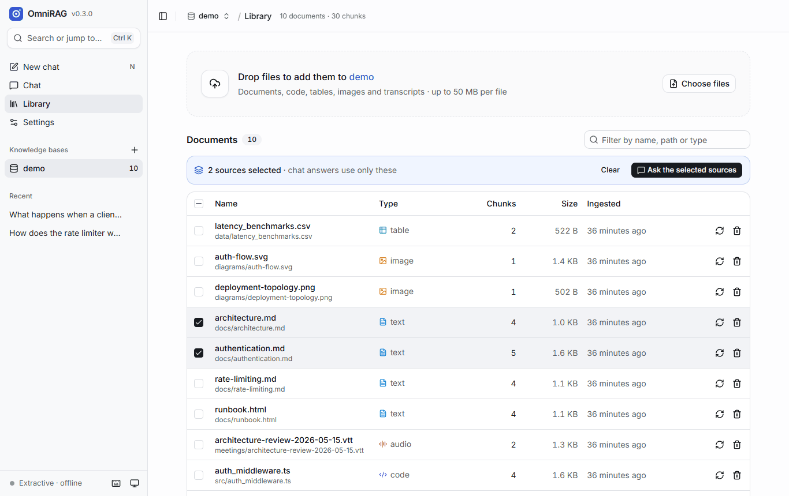
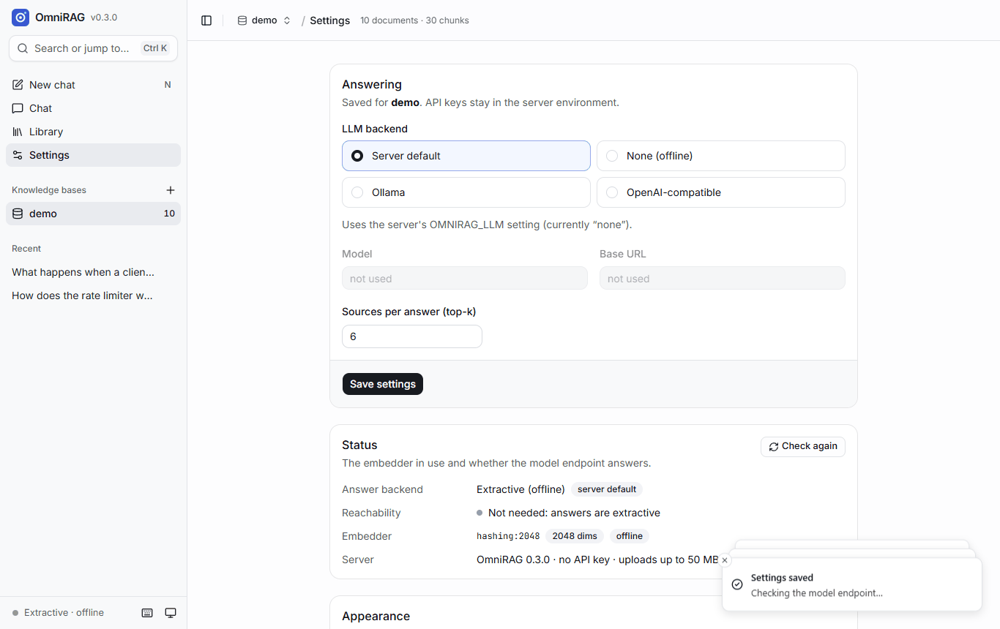
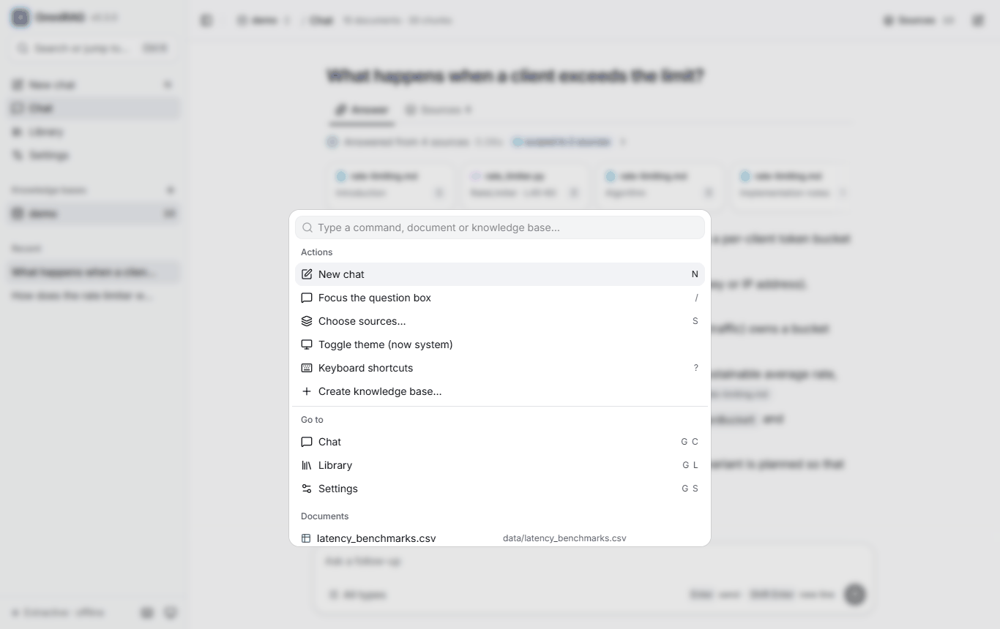
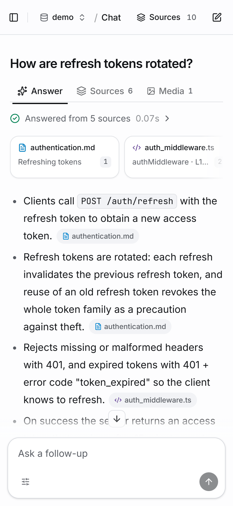

`omnirag serve` starts the HTTP API and the web app on `http://127.0.0.1:8000`
(`--host` and `--port` change that; `--kb` picks the knowledge base it opens). The app is a
React build that ships inside the Python package, works offline and loads no third-party
scripts or fonts.

## Layout

- **Sidebar:** search / command palette, *New chat*, the Chat, Library and Settings views, your
  knowledge bases (with document counts, **+** to create, trash to delete), recent
  conversations of the current knowledge base, and at the bottom the model status, keyboard
  shortcuts and the theme toggle. On a phone it is a sheet opened from the menu button.
- **Top bar:** the current knowledge base (click to switch), the view, document and chunk
  counts, and in Chat the **Sources** button and *New chat*.
- **Side panel:** source previews, document details and the source picker open on the right on
  wide screens, as a sheet on tablets and as a bottom drawer on phones.

## Asking

An empty chat shows *Ask &lt;kb&gt; anything* with starter questions phrased from the knowledge
base's headings, code symbols, table titles and transcript timestamps. Type a question and press
<kbd>Enter</kbd> (<kbd>Shift</kbd>+<kbd>Enter</kbd> for a new line). The *All types* menu limits
the question to some content types; [inline filters](/omnirag/docs/concepts/scoping/#inline-filters)
such as `source:*.py` work too.

While the answer streams, progress steps show *Searching N chunks*, *Reading K sources* and
*Writing the answer*. The send button becomes a stop button (or press <kbd>Esc</kbd>). When it
finishes, the steps collapse into *Answered from K sources in 0.04s*, which expands to the
timings, the backend used and the scope.

## Reading an answer

- Each question heads its own block with **Answer**, **Sources** and **Media** tabs (Media only
  when images were retrieved). Arrow keys move between tabs.
- **Source cards** above the text show the file, the section / lines / rows / timestamp and an
  image thumbnail; cited sources come first, retrieved-but-uncited ones are dashed and collapse
  into *+N more*.
- **Citation pills** name the cited file (`rate_limiter.py +1`). Hover or focus one to see the
  passage with your question's words highlighted; click to open it in the side panel. When all
  citations come from one file, pills show the section or lines instead.
- Below the answer: **Copy** (the answer plus its cited sources), a **context** meter that
  estimates how much source text was sent to the answerer, and for offline answers a hint to
  connect a model.
- **Related** questions point at nearby sections of the same documents that the answer did not
  cover. They are phrased offline from the document structure; no model is involved.

The **source preview** shows the cited passage between the chunks before and after it, code with
its real line numbers and syntax highlighting, images inline, *Open original* (the file as it was
ingested, served inertly), *Copy excerpt* and *Retrieval details* (score, ranks and metadata).

## Scoping to documents

Press <kbd>S</kbd> or click **Sources** to tick the documents answers may use. A *Scoped to N
sources* chip appears above the question box; × clears it. The same selection is shown as
checkboxes in the Library. See [Scoping](/omnirag/docs/concepts/scoping/).

## Library

- **Upload** by dropping files on the drop zone or with *Choose files*. Each file shows its
  progress, then *Added · N chunks*, *Updated*, *Unchanged* or the reason it failed. Files must
  have a [supported extension](/omnirag/docs/concepts/modalities/) and be under the upload limit.
- **Filter** by name, path or type.
- **Select** documents with the checkboxes to scope the chat; *Ask the selected sources* jumps
  to a new chat.
- **Re-ingest** (refresh icon) re-parses one document from its source file; **Delete** removes
  it from the index, and deletes the stored copy if it was uploaded. Files ingested from server
  paths are never deleted.
- Click a name for the **document panel**: facts, the beginning of the document, *Ask about this
  document* (scopes a new chat to it), *Add to scope* and *Open original*.

## Settings

- **Answering** (per knowledge base): LLM backend (*Server default*, *None*, *Ollama* or
  *OpenAI-compatible*), model (with suggestions from the endpoint's model list), base URL and
  sources per answer (top-k). API keys are never entered here; they come from the server
  environment.
- **Status:** the answer backend and where it is configured, the endpoint and whether it is
  reachable (with latency), the embedder and its dimensions, the server version, whether an API
  key is required and the upload limit. *Check again* re-probes.
- **Appearance:** System, Light or Dark. System follows the operating system.
- **API key:** when the server requires one, *Forget key* clears it from this browser.
- **Delete knowledge base.**

## Command palette and shortcuts

<kbd>Ctrl</kbd>+<kbd>K</kbd> (<kbd>⌘</kbd>+<kbd>K</kbd> on macOS) opens a palette for actions,
views, knowledge bases, documents and past conversations, with fuzzy search.

| Keys                         | Action                                             |
| ---------------------------- | -------------------------------------------------- |
| `Ctrl K` / `⌘ K`             | Command palette                                    |
| `/`                          | Focus the question box                             |
| `N`                          | New chat                                           |
| `S`                          | Choose sources (scope the chat)                    |
| `G` then `C` / `L` / `S`     | Go to Chat / Library / Settings                    |
| `Enter`, `Shift Enter`       | Send, new line                                     |
| `←` `→`                      | Switch answer tabs (when a tab has focus)          |
| `Ctrl B` / `⌘ B`             | Show or hide the sidebar                           |
| `Esc`                        | Stop generating, close panels and menus            |
| `?`                          | Show the shortcuts                                 |

Single-key shortcuts are ignored while you type in a field.

## Conversations and privacy

Conversations are stored in the browser's local storage (the 40 most recent), per knowledge
base, and listed under *Recent*. Deleting one offers *Undo*. Nothing about conversations is
stored on the server; the server only sees the questions as they are asked.

## Phones

At phone width the sidebar becomes a sheet, the side panel and source picker become bottom
drawers, the source strip scrolls sideways and the library table folds its columns into the name
cell.

## Accessibility

The app is keyboard-operable throughout, with visible focus rings. Dialogs, menus, tabs and
checkboxes use Radix primitives with the matching ARIA roles; the transcript is a live region
that announces finished answers and scope changes. Text colours meet WCAG AA contrast in both
themes, and animations are switched off when the system asks for reduced motion.

## API key prompt

If the server sets `OMNIRAG_API_KEY`, the app asks for the key once, checks it and keeps it in
the browser's local storage. A rejected key reopens the prompt.
