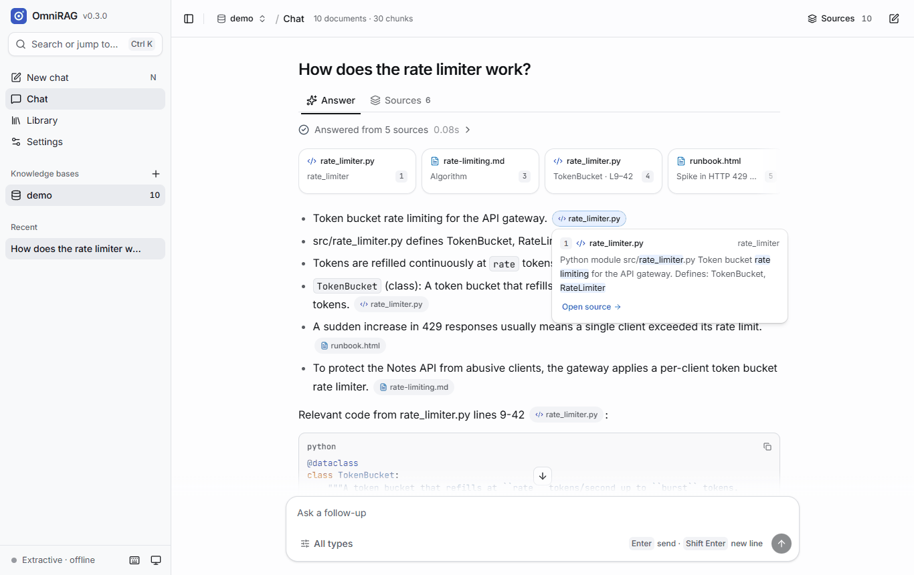

import { Card, CardGrid, LinkCard } from "@astrojs/starlight/components"

OmniRAG is a retrieval-augmented knowledge assistant for **documents, code, tables, images and
audio transcripts**. Point it at a folder, ask a question, and get an answer whose sentences carry
`[n]` citations that link back to the exact chunk, line range, table rows or transcript
timestamp they came from.

It runs **fully offline by default**: the default embedder, the BM25 index, hybrid fusion, the
reranker and the extractive answerer need nothing beyond `numpy`. Connect
[Ollama or any OpenAI-compatible endpoint](/omnirag/docs/guides/models/) when you want a language
model to write the answer.



## What you get

<CardGrid>
  <Card title="One index for every modality">
    Markdown, HTML, PDF, 18 programming languages, CSV/JSON tables, images and transcripts are
    turned into text chunks in one index and searched with one query.
  </Card>
  <Card title="Hybrid retrieval from scratch">
    Dense vectors and BM25, reciprocal rank fusion, a lexical reranker, MMR de-duplication and
    neighbouring-chunk context. No LangChain, no LlamaIndex.
  </Card>
  <Card title="Checked citations">
    Every claim carries `[n]`; citations that point at nothing are removed. The web app shows
    them as pills that name the file and preview the passage.
  </Card>
  <Card title="Four ways in">
    A web app, the `omnirag` CLI, a FastAPI HTTP API with server-sent-event streaming, and a
    Python library.
  </Card>
</CardGrid>

## How the pieces fit

```text
files ──► ingest ──► chunk ──► embed ──► store (SQLite + numpy)
                                               │
question ──► parse filters ──► dense + BM25 ──► RRF ──► rerank ──► MMR ──► neighbours
                                                                               │
                                    answer with [n] citations ◄── LLM or extractive
```

- **Ingest** routes each file by extension to a parser for its modality and describes
  non-text content in text (captions, transcripts, table statistics, code signatures).
- **Chunk** splits along the natural structure: Markdown headings, Python functions and
  classes, table rows, transcript cues.
- **Embed** maps chunks into vectors. The default hashing embedder is deterministic and needs
  no downloads.
- **Store** keeps documents, chunks, metadata and vectors in one SQLite file per knowledge base.
- **Retrieve** fuses dense and keyword search and re-scores the candidates.
- **Generate** numbers the sources, packs them into a token budget and asks a model to cite
  them, or quotes the most relevant sentences when no model is configured.

## Next steps

<CardGrid>
  <LinkCard title="Installation" href="/omnirag/docs/installation/" description="pip, uv, Docker or a source checkout." />
  <LinkCard title="Quickstart" href="/omnirag/docs/quickstart/" description="Index the sample corpus and ask your first question." />
  <LinkCard title="Web app guide" href="/omnirag/docs/guides/web-app/" description="Chat, sources, scoping, the library and settings." />
  <LinkCard title="CLI reference" href="/omnirag/docs/reference/cli/" description="Every command and flag." />
</CardGrid>
